# bc_electricity_balance

[](https://github.com/atamalfuzi/bc_electricity_balance/actions/workflows/tests.yml)

Six questions about British Columbia's electricity since 1980, each answered with open data and a method suited to it, from extreme-value statistics and regime models to machine learning and calibrated forecasts. Python, with pandas, statsmodels and scikit-learn.

**[Live dashboard](https://atamalfuzi.github.io/bc_electricity_balance/)**, rebuilt on the 15th of each month from the latest Statistics Canada, Canada Energy Regulator and US Energy Information Administration data: the latest month's demand against what the weather and season predict, hydro output and net imports over the last 12 months, what the trade cost, the last full month of hourly trade with the United States, a six-month demand forecast with calibrated ranges, the import regime and a day-ahead forecast of the hourly flow. **[Write-up with interactive charts](https://atamalfuzi.github.io/bc-electricity-balance.html).** The results below are as of October 2026 (data through July 2026).

> **Personal project.** This is my own analysis of publicly available data. It is not associated with my work for any current or past employer and does not represent their views.

| Question | Methods | Answer |
|---|---|---|
| [How rare was the drought?](#1-how-rare-was-the-drought) | Lognormal return periods, bootstrap, Theil-Sen trend | 2023 was a once-in-about-100-years low on the Fraser; 2023–2024 its driest two years since 1913 |
| [How much hydro output did it cost?](#2-how-much-hydro-output-did-low-water-cost) | Regression on reservoir inflows, leave-one-year-out | Low inflows explain 7.1 TWh (90%: 5.4–8.7) of the 11.3 TWh fall in 2023 |
| [Where did the power come from?](#3-where-did-the-power-come-from-and-at-what-cost) | Accounting identity, weather normalisation | Imports: net imports rose 14.3 TWh while fossil-fuel generation fell |
| [How does trade move hour by hour?](#4-how-does-trade-move-hour-by-hour) | k-means, principal components, Markov switching | Three kinds of trading day; a heavy-import regime from September 2022 to August 2025 |
| [Can the hourly flow be forecast?](#5-can-the-hourly-flow-be-forecast) | Ridge and gradient boosting, expanding-window tests, permutation importance, partial dependence | A day ahead, 8% better than repeating yesterday; BC's own water matters most |
| [How well can demand be forecast?](#6-how-much-is-weather-and-how-well-can-demand-be-forecast) | Seasonal ARIMA, conformal prediction, Kalman filter | To within 3.1–3.8% one to six months out, with ranges that hold as often as stated |

## What it shows

### 1. How rare was the drought?

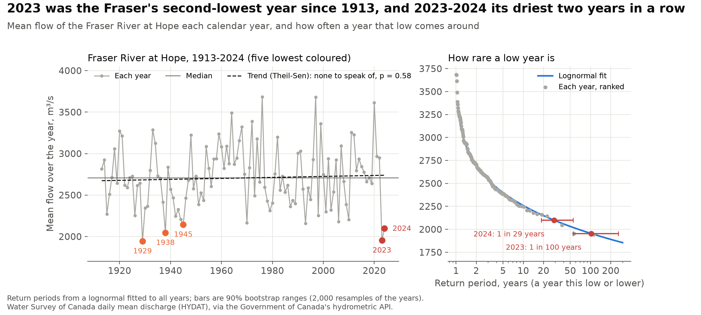

- **2023 was a once-in-about-100-years low, and 2023–2024 the driest two years in a row since 1913.** The Fraser at Hope carried 1,954 m³/s on average in 2023, 28% below its 1913–2024 median and the second-lowest of 112 years (after 1929). A lognormal fitted to all years puts a year that low at about once in 100 years (90% bootstrap range 55–259 years); 2024, the fourth-lowest, at once in 29 (18–55). Over the two years together the river ran lower than in any other two-year stretch on record. There is no long-run trend (Theil-Sen slope +59 m³/s a century, Kendall p = 0.58): the drought was rare weather, not a drying river.

### 2. How much hydro output did low water cost?

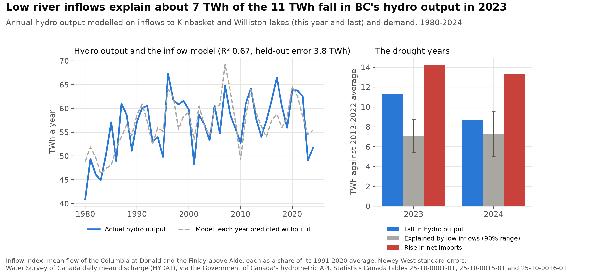

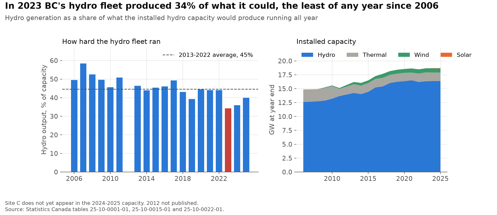

- **Low inflows explain about two thirds of the fall in hydro output.** Inflows to Kinbasket and Williston lakes, behind BC Hydro's two largest dams, ran at 79% of their 1991–2020 average in 2023 and 84% in 2024. A regression of annual hydro output on this year's and last year's inflows and demand explains two thirds of the variation since 1980 (R² 0.67) and misses a year it was not fitted to by 3.8 TWh on average. With normal inflows, all else as it was, it puts 2023's output 7.1 TWh higher (90% range 5.4–8.7), against an actual fall of 11.3 TWh from the 2013–2022 average; for 2024, 7.3 of 8.7 TWh. The other 4.7 TWh in 2023 is output the inflows alone would not have cut, consistent with BC Hydro holding water back and buying instead, which the data cannot show.
- **The hydro fleet ran at its lowest in 20 years.** In 2023 hydro output was 34% of what BC's installed hydro capacity could produce running all year, the least of any year since 2006, against 45% on average in 2013–2022; it was 36% in 2024 and 40% in 2025.

### 3. Where did the power come from, and at what cost?

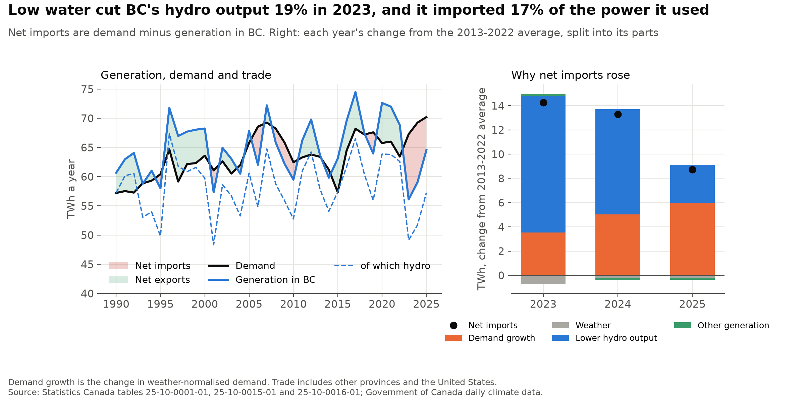

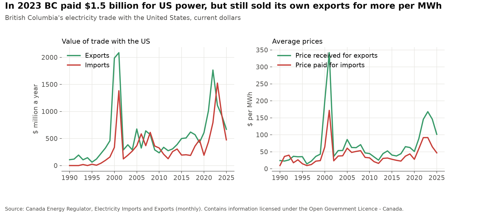

- **In 2023 BC imported 17% of the power it used.** Hydro generation fell to 49.1 TWh, against 60.4 TWh a year in 2013–2022, and net imports (receipts minus deliveries, from other provinces and the United States) reached 11.2 TWh, against average net exports of 3.1 TWh a year in 2013–2022. Of the 14.3 TWh swing, lower hydro output accounts for 11.3 TWh and growth in weather-normalised demand for 3.5 TWh; the mild weather took off 0.7 TWh.
- **BC imported rather than burning more gas.** Thermal plants (gas, oil and industrial biomass) ran at 38% of capacity, within their 2016–2022 range of 36–51%, and generation from fossil fuels fell to 1.46 TWh, from 1.61–2.11 TWh in 2020–2022.
- **By 2025 demand growth, not water, kept imports high.** Net imports were still 8.7 TWh above the 2013–2022 average in 2025, and 6.0 TWh of that is demand growth, against 3.1 TWh of lower hydro output (which includes the new Site C dam). In the 12 months to July 2026, with hydro output 9% above that average, BC was back to net exports of 2.7 TWh.
- **BC still sells high and buys low, but the drought turned trade into a cost.** In 2023 BC paid $1.52 billion for 16.6 TWh of US power ($92 per MWh) and earned $1.11 billion for 6.6 TWh of exports ($168 per MWh): a $411 million deficit, against a $972 million surplus in 2022. Trade broke even in 2024 and was back to a $196 million surplus in 2025.

### 4. How does trade move hour by hour?

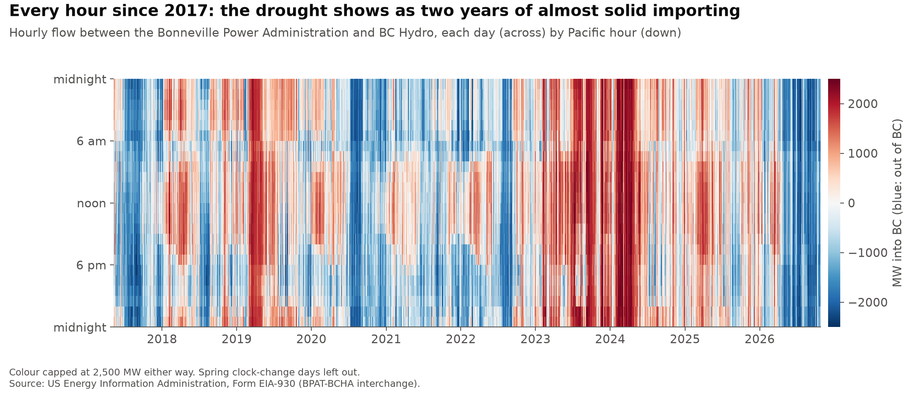

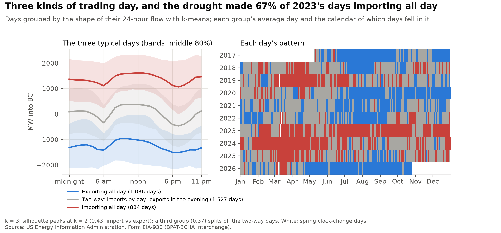

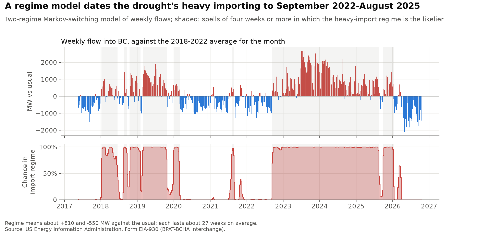

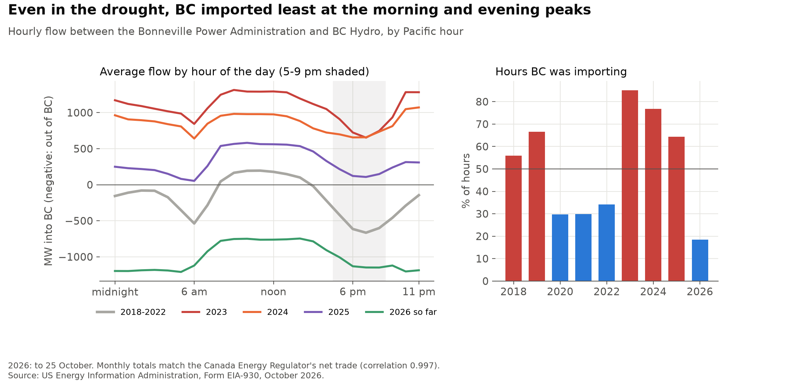

- **There are three kinds of trading day.** Grouping the 3,447 days since May 2017 by the shape of their 24-hour flow (k-means) gives days exporting all day (1,036 days, 1,250 MW out on average), days importing all day (884, 1,380 MW in), and two-way days (1,527) that import about 330 MW from 10 am to 4 pm and export about 370 MW from 5 to 9 pm. The silhouette score is highest for two groups, a plain import/export split; the third separates out the two-way days. Most of the day-to-day variation (84%) is the day's overall level, and 7% is the midday-against-evening shape. In 2023, 67% of days were importing all day; in 2026 so far, 67% are exporting all day.
- **A regime model dates the drought's heavy importing from 12 September 2022 to 17 August 2025.** A two-regime Markov-switching model of weekly flows, measured against the 2018–2022 average for the month, finds a heavy-import regime about 1,350 MW above the other, each lasting about 27 weeks on average. The drought's spell ran 153 weeks without a break, after shorter spells in the dry years 2018–2019 and before one in late 2025.
- **Even in the drought, BC imported least at the morning and evening peaks.** In normal years BC exports most from 5 to 9 pm (575 MW out on average in 2018–2022) and around 6 am, and imports a little around midday (160 MW in). In 2023 it was importing in 85% of hours, but least in the evening: 760 MW in from 5 to 9 pm, against 1,070 MW overnight and 1,270 MW from 10 am to 3 pm, consistent with saving its own water for the hours when power is dearest. In the busiest 1% of hours of 2023 and 2024, imports reached 2,420–2,440 MW, close to the most this connection has carried into BC since 2017 (2,523 MW).

### 5. Can the hourly flow be forecast?

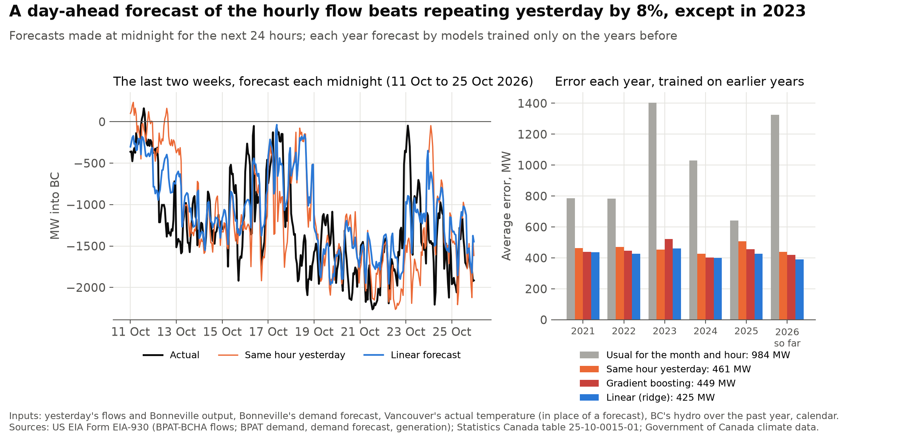

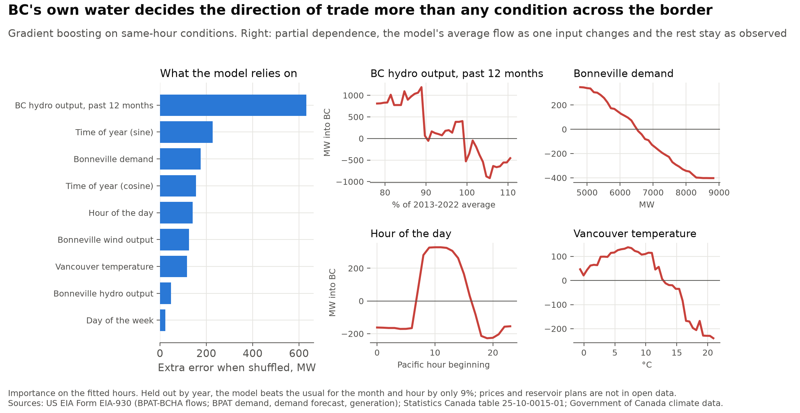

- **A day ahead, a linear model beats repeating yesterday by 8%, but not in 2023.** Forecasting each midnight for the next 24 hours, from yesterday's flows and Bonneville output, Bonneville's own demand forecast, the weather and the calendar, a ridge regression misses by 425 MW on average over 2021–2026, each year forecast by a model trained only on the years before. Repeating the same hour yesterday misses by 461 MW and the usual flow for the month and hour by 984 MW. Gradient boosting does no better than the linear model (449 MW), and in 2023 neither beat repeating yesterday: the drought took the flows outside anything in the training years, where trees in particular cannot extrapolate.
- **BC's own water decides the direction of trade more than any condition across the border.** A gradient-boosting model of the flow on same-hour conditions leans most on BC's hydro output over the past year (permutation importance 632 MW, against 175 MW for Bonneville's demand). By partial dependence, at 78% of normal hydro output it expects about 810 MW into BC and at 111% about 460 MW out; higher Bonneville demand pulls power out of BC. These conditions alone beat the usual for the month and hour by only 9% in years held out, because trading also turns on prices and reservoir plans that are not in open data.

### 6. How much is weather, and how well can demand be forecast?

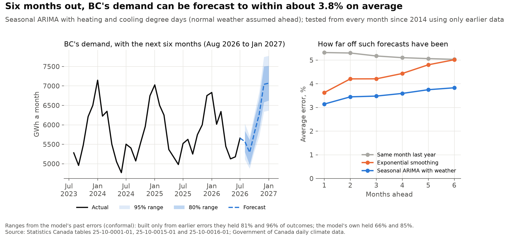

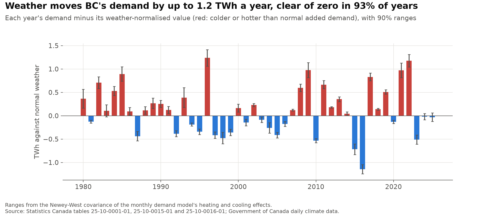

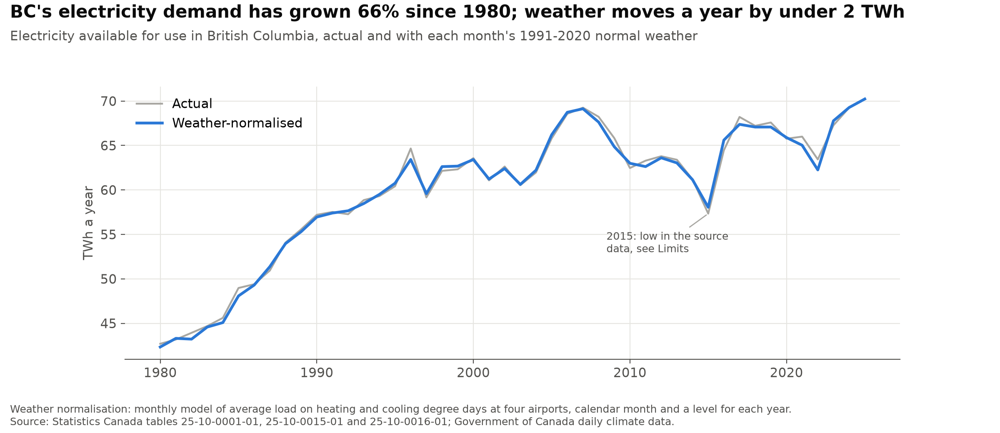

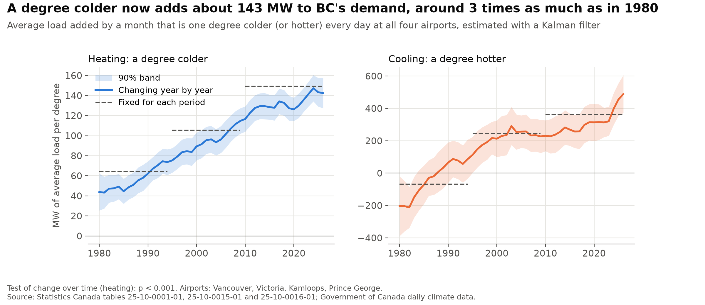

- **Monthly demand can be forecast to within 3.1% a month ahead and 3.8% six months ahead.** Tested from every month since December 2014 using only the data before it, a seasonal ARIMA with heating and cooling degree days (normal weather assumed for the months ahead) beats exponential smoothing (3.6–5.0%) and the same month last year (5.0–5.3%). Its own 80% and 95% ranges held only 66% and 85% of outcomes, because they treat the weather ahead as known. Ranges set from its past errors (conformal prediction) held 81% and 96% when built only from errors known at the time.
- **Demand has grown two thirds since 1980, and weather explains little of it.** Weather-normalised demand rose from 42.3 TWh in 1980 to 69.1 TWh in 2007, fell to about 61 TWh by 2014 and rose again to 70.2 TWh in 2025. Weather moved any single year by at most 1.2 TWh, and its effect is clear of zero (90% range) in most years.
- **Demand responds three times as much to a cold month as in 1980.** A month that is one degree colder every day at all four airports now adds about 143 MW of average load (90% band 129–158), against 44 MW in 1980 (25–62), while demand itself grew 1.7 times. A degree hotter adds about 455 MW (355–556) in 2025, up from about 210 MW around 2000; before the mid-1990s, when hot months were rare, the cooling estimate is imprecise, and even negative in the early 1980s. Both changes are statistically clear (likelihood-ratio tests, p < 0.001). The data cannot show the cause; electric heating, heat pumps and air conditioning are the obvious candidates.

## Method

**Data preparation.** Monthly generation (total and hydro), receipts, deliveries and electricity available for use in BC come from Statistics Canada's monthly electric power tables: one for 1950–2007 and two from 2008 that report the same items. Electricity available for use (generation plus receipts minus deliveries) stands in for demand; it includes transmission losses and power that industry generates for itself. Net imports are receipts minus deliveries. The value and volume of trade with the United States come from the Canada Energy Regulator, whose volumes match Statistics Canada's. Installed capacity by type comes from Statistics Canada's annual table, at year end. Heating and cooling degree days below and above 18 °C come from daily mean temperatures at the Vancouver, Victoria, Kamloops and Prince George airports, joining each airport's old and new station records and averaging the four. Months with fewer than 14 days of readings are dropped and the rest scaled up to the full month; the two months this drops at Kamloops (1992–1993) are filled from the other airports plus Kamloops's usual gap to them in that calendar month.

**1. Weather-normalised demand** ([`balance.py`](balance.py)). A least-squares regression of monthly average load (MW) on a level for each year, calendar month, and heating and cooling degrees per day with separate effects for 1980–1994, 1995–2009 and 2010 onward, with standard errors robust to a year of autocorrelation. It explains 97% of the monthly variation. Each month's weather-normalised load replaces its actual degree days with that calendar month's 1991–2020 average, at its period's effects. Each year's weather effect is a linear combination of the heating and cooling coefficients, so its 90% range comes straight from their Newey-West covariance ([`forecast.py`](forecast.py)).

**2. The import swing.** Net imports equal demand minus generation, so each year's change from the 2013–2022 average splits exactly into the change in weather-normalised demand, the change in the weather's effect, lower hydro output and lower other generation. This is an accounting split, not a statement of cause. A capacity factor is a year's output divided by what the installed capacity would produce running all year.

**3. Change in the temperature response.** A state-space model of monthly average load:

- a smooth trend for the structural level
- a heating effect and a cooling effect that follow random walks and can move each January
- calendar-month effects, held fixed
- an error that carries over from month to month (AR(1))

The shock variances and the error's persistence are estimated by maximum likelihood, and the Kalman smoother traces each effect with a 90% band. Likelihood-ratio tests compare it with constant effects; because the variance being tested sits on the boundary (zero), the p-values are half the chi-squared ones. The chart compares the yearly effects with the period effects from model 1.

**4. Hourly flows.** The US Energy Information Administration's Form EIA-930 gives each US balancing authority's hourly flow with its neighbours, in one file per half-year. BC Hydro's only reported US neighbour is the Bonneville Power Administration, so the flow on that connection, signed as into BC, stands for BC's trade with the United States. The data start on 10 May 2017; earlier rows are placeholder zeros. Hours are grouped by the Pacific time they begin. Monthly totals match the Canada Energy Regulator's net trade closely (correlation 0.997 from May 2017 to July 2026, an average difference of 39 GWh a month). The hourly flows, and Bonneville's demand and output, for past half-years are stored in [`flows/`](flows) so that a run downloads only the later files.

**5. River flows and return periods** ([`rivers.py`](rivers.py)). Daily mean flows at Water Survey of Canada gauges, averaged over each calendar year with at least 355 days of readings. The Fraser at Hope, unregulated along its main stem and recorded since 1912, gives the long view: a lognormal fitted to all 112 years gives the return period of a year as low as 2023, refitted to 2,000 bootstrap resamples of the years for a 90% range, and a Theil-Sen slope with Kendall's test checks for a trend. Return periods use the Weibull plotting position, (n + 1) / rank, for the chart's points.

**6. Inflows and hydro output** ([`rivers.py`](rivers.py)). An inflow index averages the Columbia at Donald (above Kinbasket Lake and the Mica Dam) and the Finlay above the Akie (into Williston Lake and the W.A.C. Bennett Dam), each as a share of its 1991–2020 average. A least-squares regression of annual hydro output on this year's index, last year's (for water carried over in the reservoirs) and demand, with Newey-West errors, is checked by predicting each year from a fit without it. Output with normal inflows, all else as it was, is a linear combination of the coefficients, with its own 90% range.

**7. Kinds of trading day and import regimes** ([`trading.py`](trading.py)). Each day's 24 hourly flows form one profile; days missing an hour (the spring clock change) are dropped and the autumn's repeated hour averaged. k-means (20 starts) groups the profiles; the silhouette score is compared for 2 to 7 groups, and principal components show how much of the variation is level and how much shape. For regimes, weekly mean flows less the 2018–2022 average for their month feed a two-regime Markov-switching model with switching means and variances, estimated by maximum likelihood with 30 random starts; a spell is a run of four weeks or more in which the heavy-import regime is the likelier. The likelihood is flat near its peak, so reruns can move the regime means by a few MW without changing the spells.

**8. Hourly models** ([`trading.py`](trading.py)). The day-ahead forecast uses only what is known at the midnight before: the flow at the same hour yesterday and a week before, yesterday's average and last hour, yesterday's average Bonneville hydro and wind output, Bonneville's own day-ahead demand forecast, Vancouver's temperature that day, BC's hydro output over the 12 months to the month before (as a share of its 2013–2022 average), and the calendar. A ridge regression (calendar as categories, the rest standardised) and gradient boosting (scikit-learn's histogram-based regressor) are trained on all years before each test year from 2021, and compared with repeating yesterday and with the training years' average for the month and hour. A test checks that a day's own flows never enter its inputs. The drivers model is gradient boosting on same-hour conditions only (no past flows), read with permutation importance on 20,000 sampled hours and partial dependence, and checked by leaving out a year at a time.

**9. Demand forecasts and conformal ranges** ([`forecast.py`](forecast.py)). From every month since December 2014, three methods forecast the next six months of average load from the data since 2000 up to that month: the same month last year; exponential smoothing with a damped trend and additive seasons; and a seasonal ARIMA (1,0,1)(0,1,1)₁₂ with heating and cooling degree days, given the 1991–2020 normal degree days for the months ahead. Conformal ranges take, for each horizon, the 80th and 95th percentiles of the ARIMA's absolute % errors; their coverage is checked as it would have run, using at each origin only the errors already known (after the first 24).

All estimates are in [`output/`](output): annual demand, generation, capacity and trade in [`annual.csv`](output/annual.csv), the import swing in [`drought.csv`](output/drought.csv), trade in [`trade.csv`](output/trade.csv), hourly flows by year and hour in [`flows_by_year.csv`](output/flows_by_year.csv) and [`flows_by_hour.csv`](output/flows_by_hour.csv), the yearly temperature effects in [`temperature_effect.csv`](output/temperature_effect.csv), river flows and the inflow index in [`rivers.csv`](output/rivers.csv), the inflow model in [`water_to_power.csv`](output/water_to_power.csv) and [`low_water.csv`](output/low_water.csv), the kinds of day in [`patterns_by_year.csv`](output/patterns_by_year.csv) and [`pattern_profiles.csv`](output/pattern_profiles.csv), the regime model in [`import_regime.csv`](output/import_regime.csv) and [`import_spells.csv`](output/import_spells.csv), the hourly models in [`flow_forecast_errors.csv`](output/flow_forecast_errors.csv) and [`flow_drivers.csv`](output/flow_drivers.csv), and the demand forecasts in [`demand_forecast.csv`](output/demand_forecast.csv), [`demand_forecast_errors.csv`](output/demand_forecast_errors.csv) and [`weather_effect.csv`](output/weather_effect.csv). [`balance-data.js`](output/balance-data.js) holds the data behind the write-up's interactive charts. The tests in [`tests/`](tests) run on every push and need no downloads; they check the data handling and each method on data built to a known answer, from the state-space model recovering a drifting effect to the regime model finding a known spell and the conformal ranges holding as stated.

## Limits

- **2015 looks wrong in the source data.** Statistics Canada's figure for electricity available for use in 2015 is about 4 TWh below the years either side, mostly from April to September, when reported deliveries out of BC were high. Weather does not explain it, and I have not found the cause, so 2015 is kept as reported and flagged on the chart. It sits inside the 2013–2022 baseline, where it lowers average demand by about 0.4 TWh.
- **Two gauges stand in for the reservoirs' inflows,** and the river archive runs only to early 2025 and is updated about once a year, so the river results move yearly, not monthly.
- **Hourly flows cover one connection, and only with the United States.** The flow between BC Hydro and the Bonneville Power Administration matches BC's US trade closely, but there is no openly licensed hourly data for BC's demand, its trade with Alberta or market prices, which caps how well the flow can be explained.
- **The day-ahead forecast uses the day's actual Vancouver temperature** in place of a forecast, so it is slightly optimistic.
- **Partial dependence and permutation importance describe the fitted model,** not what would happen if one condition changed alone; the inputs move together.
- **Conformal ranges assume the future errors look like the past ones;** a shock unlike 2014–2026 would break that.
- **Site C is missing from the capacity data.** Statistics Canada's hydro capacity barely changes from 2023 to 2025, so Site C's units do not appear to be counted yet, and the 2024–2025 hydro capacity factors may be overstated.
- **Thermal capacity includes industrial biomass,** so its capacity factor is not the gas fleet's alone.
- **Demand is a residual.** Electricity available for use includes losses and industrial self-generation, and it moves with industry: the fall from 2007 to 2014 and the later rise include the 2009 recession and changes in industrial demand, which the year levels and the trend do not separate.
- **Four airports stand in for the province,** equally weighted, with no population weighting. The cooling effect rests on few hot months, so it is much less precise than the heating effect.
- **Trade values are in current dollars** and cover trade with the United States only; trade with Alberta appears in the volumes but not the values.

## Data

The scripts download everything themselves:

| Data | Source | Licence |
|---|---|---|
| Monthly electric power statistics, 1950–2007 | Statistics Canada, [table 25-10-0001-01](https://www150.statcan.gc.ca/t1/tbl1/en/tv.action?pid=2510000101) | [Statistics Canada Open Licence](https://www.statcan.gc.ca/en/terms-conditions/open-licence) |
| Monthly generation by type of electricity, 2008 onward | Statistics Canada, [table 25-10-0015-01](https://www150.statcan.gc.ca/t1/tbl1/en/tv.action?pid=2510001501) | Statistics Canada Open Licence |
| Monthly receipts, deliveries and availability of electricity, 2008 onward | Statistics Canada, [table 25-10-0016-01](https://www150.statcan.gc.ca/t1/tbl1/en/tv.action?pid=2510001601) | Statistics Canada Open Licence |
| Monthly electricity exports and imports by province and US state, volume and value, 1990 onward | Canada Energy Regulator, [Electricity – Imports and Exports](https://open.canada.ca/data/en/dataset/5c358f51-bc8c-4565-854d-9d2e35e6b178) | [Open Government Licence – Canada](https://open.canada.ca/en/open-government-licence-canada) |
| Annual installed generating capacity by type, 2006 onward | Statistics Canada, [table 25-10-0022-01](https://www150.statcan.gc.ca/t1/tbl1/en/tv.action?pid=2510002201) | Statistics Canada Open Licence |
| Hourly flow between BC Hydro and the Bonneville Power Administration, May 2017 onward | US Energy Information Administration, [Form EIA-930](https://www.eia.gov/electricity/gridmonitor/) six-month interchange files | [Public domain](https://www.eia.gov/about/copyrights_reuse.php) |
| Bonneville's hourly demand, day-ahead demand forecast and hydro and wind output, July 2017 onward | US Energy Information Administration, Form EIA-930 six-month balance files | Public domain |
| Daily mean river flow: Fraser at Hope (08MF005), Columbia at Donald (08NB005), Finlay above Akie (07EA005) | Water Survey of Canada (HYDAT), via the [MSC GeoMet API](https://api.weather.gc.ca/collections/hydrometric-daily-mean) | Open Government Licence – Canada |
| Daily mean temperature at four airports | Government of Canada historical climate data, via the [MSC GeoMet API](https://api.weather.gc.ca/collections/climate-daily) | Open Government Licence – Canada |

Adapted from Statistics Canada, tables 25-10-0001-01, 25-10-0015-01, 25-10-0016-01 and 25-10-0022-01. This does not constitute an endorsement by Statistics Canada of this product. Contains information licensed under the Open Government Licence – Canada. Hourly flows and Bonneville data: US Energy Information Administration, Form EIA-930 (retrieved October 2026).

## Run it

Python 3.12:

```
python -m venv .venv
.venv\Scripts\activate          # Windows; on macOS or Linux: source .venv/bin/activate
pip install -r requirements.txt
python balance.py
python rivers.py
python trading.py
python forecast.py
```

Run them from the repository folder, in this order. The first run downloads about 110 MB into `data/`, most of it the current half-year of EIA's two hourly files; later runs reuse those files (delete them to download again). `balance.py` and `rivers.py` take seconds once the data are in, `trading.py` about a minute and `forecast.py` about five, most of it the forecast backtest. They write the charts to `figures/` and the tables to `output/`, and print the estimates.

To run the tests: `pip install -r requirements-dev.txt`, then `pytest`. They need no downloads.

To build the dashboard, run `python dashboard.py` after the four analyses. It writes a static site to `site/` and stops without writing if the latest data have gaps or implausible values. Delete `data/` first to pick up the newest month. The [dashboard workflow](.github/workflows/dashboard.yml) does all of this on the 15th of each month and publishes `site/` with GitHub Pages.

## License

Code: [MIT](LICENSE).
